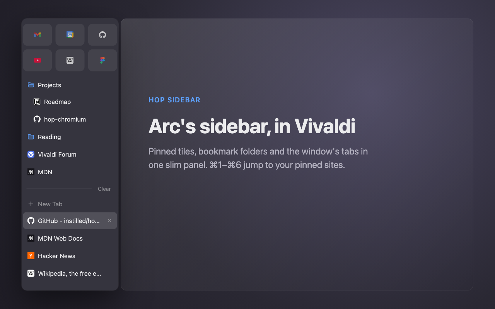
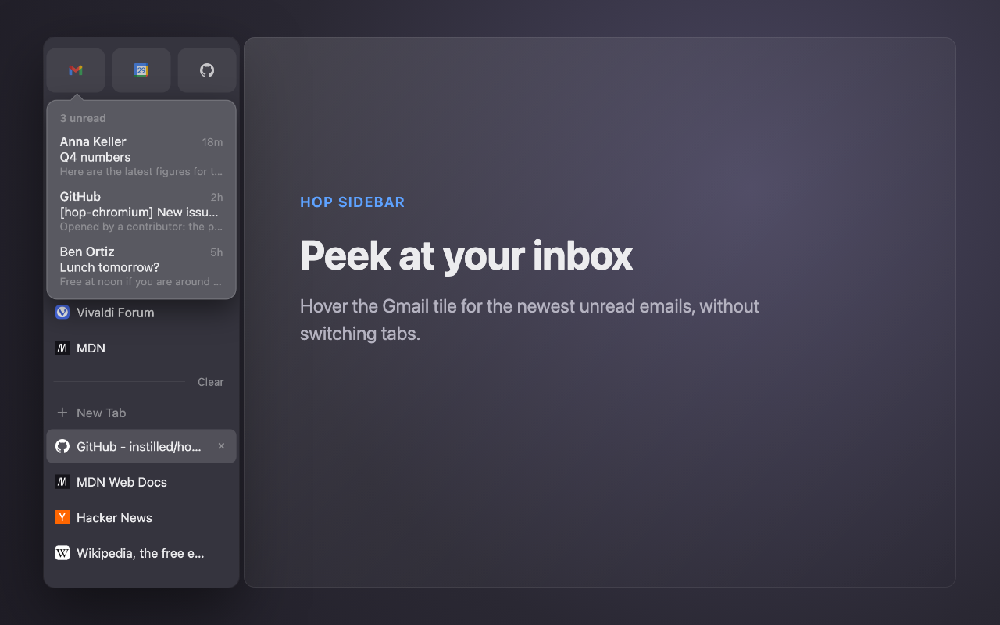
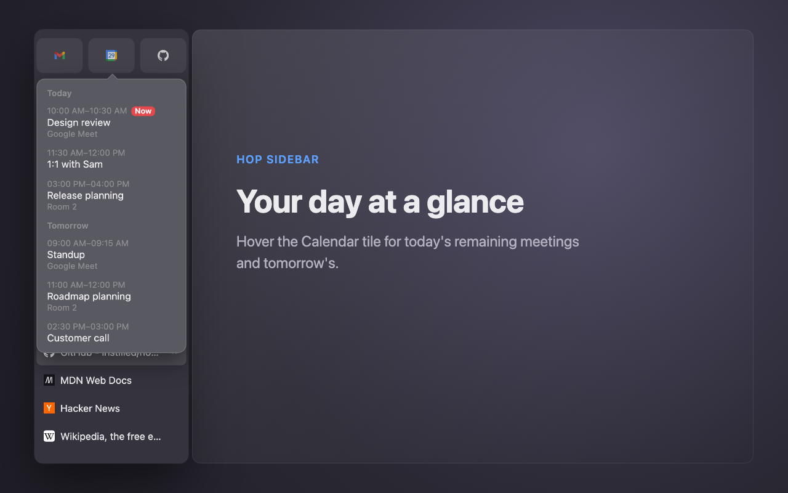
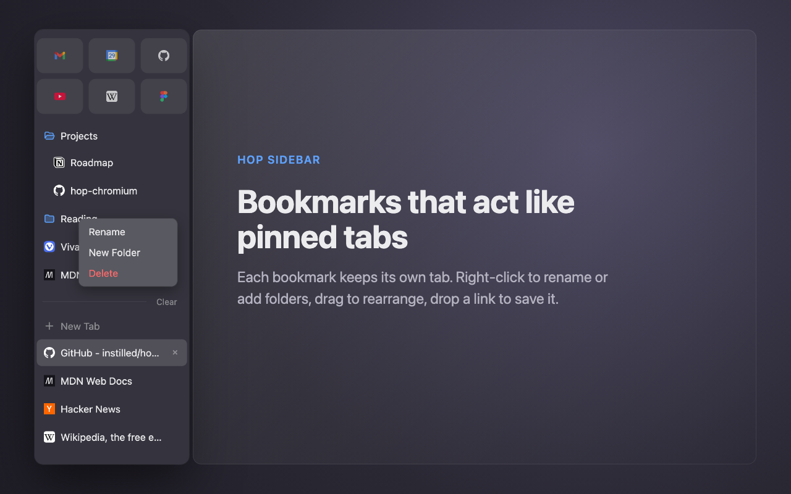
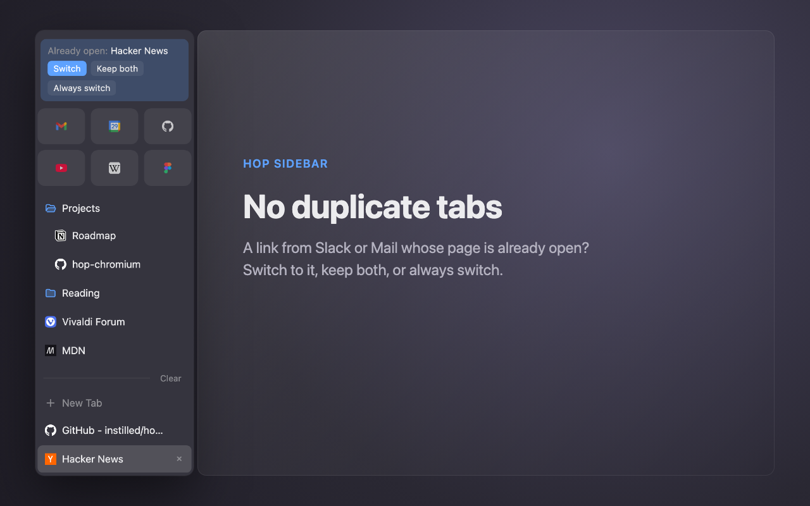

# Hop Sidebar

An Arc-style sidebar for Vivaldi: pinned tiles with previews, bookmarks that act like Arc's pinned tabs, and the
window's tabs, in a slim panel that replaces Vivaldi's panel bar. A plain extension plus a CSS mod; nothing to build.



<table>
  <tr>
    <td></td>
    <td></td>
  </tr>
  <tr>
    <td></td>
    <td></td>
  </tr>
</table>

### Why Vivaldi

It's a plain Chromium extension, so it works in Chrome too: load it the same way at `chrome://extensions` and it
opens in Chrome's side panel (Settings → Appearance → *Side panel* → *Show on left*). But Chrome keeps its tab strip,
won't make the side panel narrower than 360 px, and gives the extension no way to change that. Vivaldi shows the
extension as a panel, and its CSS UI mods can hide the panel bar and the tab bar and slim the panel to 220 px. That
gets close to Arc's single sidebar with nothing else around the page, while staying on a maintained Chromium browser.

## What it does

- **Pinned:** bookmarks in a folder named **Pinned** show as a grid of icons at the top. ⌘1–⌘6 select the first six.
- **Bookmarks** of the bookmarks bar, plus *Other* / *Mobile*. Each opens one tab bound to it, like Arc's pinned
  tabs: click it again to return to that tab. **×** or middle-click closes it; ⌘-click opens a plain tab.
- **Unread badges** from tab titles (Gmail, WhatsApp, Outlook, Slack, …).
- **Previews** on hover: unread Gmail, today's and tomorrow's Calendar events (secret iCal address in Options),
  recent Google Chat conversations (Chat tab must be open). Cached, so they show instantly.
- **Edit:** right-click for *Rename · New Folder · Delete*; drag to rearrange; drop a tab or link to bookmark it.
- **Tabs** of the window, with tab groups, below. **Clear** closes loose tabs, like Arc; **+ New Tab** below it.
- **No duplicate tabs from other apps:** a link from Slack, Mail and so on whose page is already open asks at the top
  of the sidebar: *Switch* (close the new tab), *Keep both* or *Always switch*. Set it to ask, switch or off in Options.
- **Setup page** on install: how to open the sidebar, pin sites and set shortcuts, the calendar address, the Vivaldi
  UI mod, and **import from Arc**: favorites become pinned sites, each space's pinned tabs a bookmark folder.
- **Options:** background colour (default `#35343E`), the calendar address, and how to handle duplicate tabs.

## Install

```
install.sh                            sets up Hop Sidebar in Vivaldi
code/hop-chromium-extension/          the extension
code/hop-chromium-extension/vivaldi/  the Vivaldi UI mod (CSS)
code/hop-macos/, build.sh             Hop for macOS, an older companion app (see the end)
```

Tested with Vivaldi 8.2 on macOS.

1. Quit Vivaldi, then:
   ```sh
   git clone https://github.com/instilled/hop-chromium && cd hop-chromium && ./install.sh
   ```
   For every profile this enables CSS mods, points *Custom UI Modifications* at the CSS mod and sets the panel
   width. Changed settings files are backed up as `*.hop-backup`.
2. In each profile: `vivaldi://extensions` → *Developer mode* → *Load unpacked* → `code/hop-chromium-extension`
   (the path is on the clipboard). This can't be scripted: Vivaldi drops extensions loaded any other way (command
   line, DevTools protocol) on its next start. Then quit Vivaldi and run `./install.sh` again: Vivaldi saves the new
   panel at 295 px, and the page stays laid out that wide (cut off on the right) until the script resets it.
3. Toggle the panel with ⌘E → *Toggle Current Panel*, or bind it in Settings → Keyboard. Keep it non-floating.
4. Shortcuts at `vivaldi://extensions/shortcuts`: ⌃S and ⌘1–⌘3 are preset, assign ⌘4–⌘6 yourself. Clear Vivaldi's
   own *Switch to Tab 1–6* in Settings → Keyboard if they clash.
5. For the Calendar preview: in Google Calendar → Settings → your calendar → *Integrate calendar*, copy the *Secret
   address in iCal format* and paste it into the extension's Options (`vivaldi://extensions` → Hop Sidebar → *Details* → *Extension options*). Do this in
   each profile; Gmail and Chat previews need no setup.

After `git pull`, reload the extension on its card.

### The Vivaldi UI mod

`hide-panel-bar.css` hides the panel bar, fixes the panel at 220 px (Vivaldi's own minimum is 260), and removes the
web panel's title row, border and shadow. To set it up by hand: enable *Allow for using CSS modifications* in
`vivaldi://experiments`, choose `code/hop-chromium-extension/vivaldi` in Settings → Appearance → *Custom UI Modifications*, restart.

To change the width, edit `--hop-panel-width` and run `./install.sh` again (with Vivaldi quit). To undo, clear the
folder setting and restart. CSS mods are unofficial, so a Vivaldi update may break them.

## Limitations

- `javascript:` bookmarklets don't run from the sidebar.
- Profiles can't share a window; for several spaces in one window, use Vivaldi's Workspaces.

## Hop for macOS

No longer developed; I don't use it anymore. It still builds (`./build.sh --install`) and works with Chrome and
Vivaldi. See [its README](code/hop-macos/README.md).

A menu bar app for Arc's keyboard flow: ⌥⌘←/→ switches profiles (Chrome only), links from other apps open in a
mini window like Little Arc, and ⌘O keeps that page as a tab. Unlike link launchers such as Choosy, Finicky or Velja,
which route links by rules, Hop follows what you're doing: it opens links in the profile you used last.

## License

[MIT](LICENSE)
